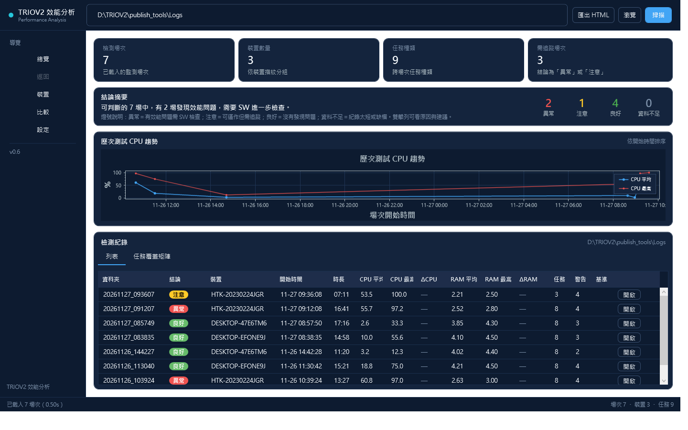
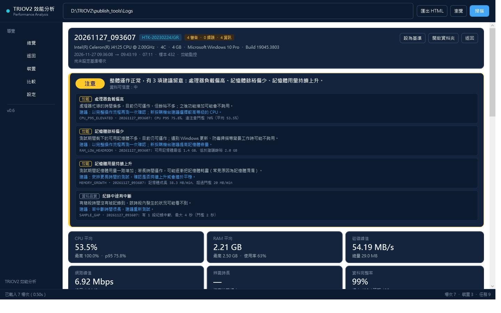
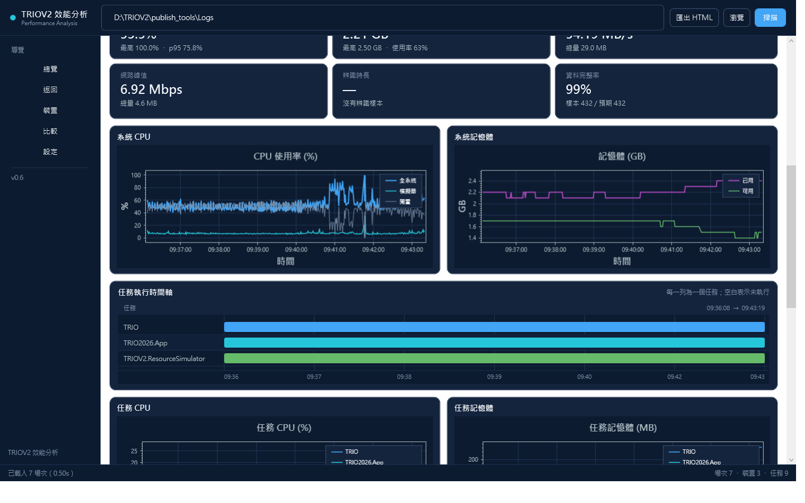
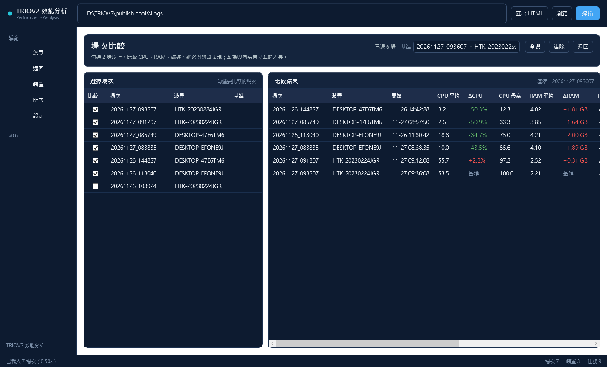
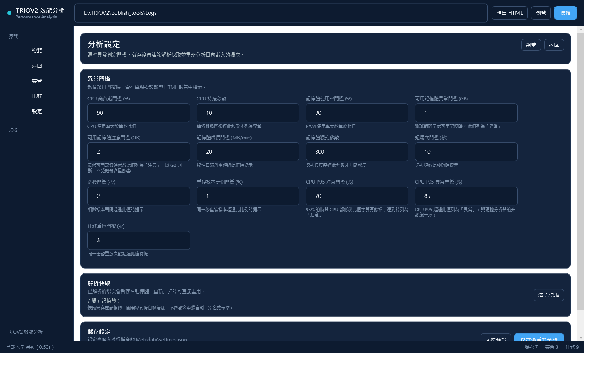

# TRIOV2 效能分析工具 使用手冊

版本：0.6.0　｜　更新日期：2026-11-27
工具檔名：`TRIOV2.PerformanceAnalysis.exe`（免安裝，雙擊即可執行）

---

## 這份手冊怎麼讀

依照你的角色，只需要讀對應的章節：

| 你是… | 想做什麼 | 建議閱讀 | 時間 |
|---|---|---|---|
| **主管／決策者** | 看結論、判斷要不要處理 | [第 1 章](#1-一分鐘認識這個工具)、[第 4 章](#4-主管快速判讀3-分鐘) | 5 分鐘 |
| **測試執行者**（產線、驗證、PM） | 收集數據、產生報告給主管 | 第 1 – 4 章 | 15 分鐘 |
| **SW 工程師** | 找出效能問題的根因 | 全部，重點在 [第 5 – 7 章](#5-sw-深入分析) | 30 分鐘 |

---

## 1. 一分鐘認識這個工具

TRIOV2 儀器的電腦上有一個「效能資源監控紀錄器」，會每秒記下 CPU、記憶體、硬碟、網路等使用情況。
**效能分析工具**讀取這些紀錄，自動回答三個問題：

1. **這次測試的結果好不好？** → 每一場測試都有一個**結論燈號**
2. **如果不好，問題在哪裡？該找誰處理？** → 每個燈號都附上白話原因與建議動作
3. **跟以前比是變好還是變差？** → 可指定一場「基準」來比較

這個工具**只讀取**紀錄檔，不會修改原始資料，也不需要網路。

### 結論燈號

| 燈號 | 意思 | 你要做什麼 |
|---|---|---|
| 🟢 **良好** | 沒有發現需要處理的問題 | 不需要動作 |
| 🟡 **注意** | 可以正常運作，但有項目建議追蹤 | 列入追蹤，必要時安排長時間測試 |
| 🔴 **異常** | 發現效能問題 | 請 SW 檢查並回覆原因與對策 |
| ⚪ **資料不足** | 紀錄太短或缺檔，不能拿來下結論 | 重新測試，不要以這一場做判斷 |

---

## 2. 取得數據（在受測儀器上）

> 這一章給**負責跑測試的人**。如果你只負責看報告，可以跳到[第 4 章](#4-主管快速判讀3-分鐘)。

### 2.1 開始記錄

1. 在受測電腦上，開啟 `Tools` 資料夾（隨身碟部署時，在隨身碟的 `Tools` 資料夾），雙擊 **`啟動效能資源監控紀錄器.bat`**。
2. 在紀錄器中**勾選要監測的程式**，例如 `TRIOV2.App`、`TRIOV2.PrivilegedService`。
   - 沒勾選任何程式也能記錄，但分析時只看得到整台電腦的數字，看不出是哪個程式造成的。
3. 按 **開始紀錄**，然後照正常流程操作儀器。
4. 測試完成後按 **⏹ 停止紀錄**。紀錄器會自動存檔。

> **測試時間建議至少 5 分鐘。** 低於 10 秒的紀錄會被判為「資料不足」；只有幾十秒的紀錄雖然可以分析，參考價值也有限。

### 2.2 紀錄存在哪裡

每按一次「開始／停止」就會產生**一個場次資料夾**，以開始時間命名：

```text
Tools\ResourceSimulator\Logs\
└── 20261112_150751\                 ← 一個場次（2026-11-12 15:07:51 開始）
    ├── ref.txt                       ← 電腦硬體資訊與摘要
    ├── System_BenchmarkLog.csv       ← 整台電腦的每秒紀錄（最重要）
    ├── TRIOV2.App\
    │   └── TRIOV2.App_BenchmarkLog.csv
    └── TRIOV2.PrivilegedService\
        └── TRIOV2.PrivilegedService_BenchmarkLog.csv
```

### 2.3 把紀錄帶回來

- **整個場次資料夾一起複製**（例如 `20261112_150751` 整個資料夾），不要只挑單一檔案。缺少 `ref.txt` 時，工具可能無法辨識是哪一台電腦。
- 多台儀器的紀錄建議依機台分資料夾存放，工具會自動辨識：

```text
效能紀錄\
├── 機台A\
│   ├── 20261112_150751\
│   └── 20261113_093010\
└── 機台B\
    └── 20261112_160203\
```

---

## 3. 開始分析（在你的電腦上）

### 3.1 開啟工具

雙擊 `TRIOV2.PerformanceAnalysis.exe`。不需要安裝，Windows 10／11 都可以執行。

> 工具放在專案的 `src\Tools\PerformanceAnalysisO\publish\` 資料夾。可以把 exe 複製到任何地方使用，但同一個資料夾內會自動建立 `Metadata` 子資料夾，用來保存你設定的備註、基準與門檻，請保留這個子資料夾。

### 3.2 載入紀錄

三種方式擇一：

- **拖曳**：把紀錄資料夾直接拖進工具視窗。
- **瀏覽**：按右上角「瀏覽」選擇資料夾。
- **輸入路徑**：在上方路徑欄輸入後按 Enter 或「掃描」。

| 你選的資料夾 | 工具的反應 |
|---|---|
| 單一場次（例如 `20261112_150751`） | 直接開啟該場次的分析頁 |
| 包含多個場次的上層資料夾（例如 `Logs`、`效能紀錄`） | 開啟總覽，列出所有場次 |

### 3.3 產生報告分享給主管

按右上角 **「匯出 HTML」**，工具會產生一個 `.html` 檔並自動用瀏覽器開啟。

- 這個檔案**可以直接用 Email、Teams 傳送**，對方用瀏覽器（Edge、Chrome）打開即可，不需要安裝任何東西。
- 報告內容與工具畫面相同：結論摘要、燈號、原因、圖表、比較。
- 報告右上角可切換**淺色／深色**，也可以按**「列印 / PDF」**另存成 PDF。

---

## 4. 主管快速判讀（3 分鐘）

### 步驟 1：看「結論摘要」

打開工具或 HTML 報告，最上方的**結論摘要**用一句話告訴你整體狀況，旁邊是四種燈號各有幾場。



讀法：

- **「需追蹤場次」**＝結論為「異常」或「注意」的場次數。是 0 就代表沒有需要追蹤的項目。
- 「資料不足」的場次**不列入判斷**，通常是試跑或操作失誤產生的短紀錄，可以忽略。

### 步驟 2：看「檢測紀錄」表的「結論」欄

每一列是一次測試，第二欄是燈號。滑鼠停在燈號上會顯示一句話說明。

### 步驟 3：點開有燈號的場次看原因

雙擊那一列（HTML 報告則是點一下），進入單場次頁。最上方的**結論卡片**會列出：



- **燈號與一句話結論**，例如「整體運作正常，有 2 項建議留意：處理器負載偏高、記憶體用量持續上升」
- **資料可信度**：高／中／低。「中」代表紀錄有小缺漏，結論仍可參考；「低」代表不能下結論。
- **每一項發現**都分成四行：
  1. 類別（效能／測試涵蓋／資料品質）與標題
  2. 白話說明：這代表什麼
  3. **建議**：下一步該做什麼、找誰
  4. 技術細節（灰色小字，給 SW 對照用）

### 步驟 4：做決定

| 看到的狀況 | 建議決策 |
|---|---|
| 全部「良好」 | 效能沒有問題，可以進入下一階段 |
| 有「注意」 | 不阻擋進度；請負責人在下次測試追蹤，必要時安排長時間測試 |
| 有「異常」 | 請 SW 依結論卡片的「建議」調查，並在下次測試確認改善 |
| 大多是「資料不足」 | 測試方式需要調整，請測試人員依[第 2 章](#2-取得數據在受測儀器上)重新收集 |

### 常見名詞白話對照

| 畫面上的詞 | 白話意思 |
|---|---|
| CPU（處理器）使用率 | 電腦運算能力用掉多少。越高越忙，長時間接近 100% 就可能卡頓 |
| RAM（記憶體） | 程式執行時占用的工作空間，單位 GB。接近電腦上限時會變慢 |
| 記憶體成長 | 測試中記憶體用量持續增加。長時間下去可能耗盡，俗稱「記憶體洩漏」 |
| 峰值 | 測試期間出現過的最高值 |
| p95 | 95% 的時間都低於這個數字。比「最高」更能代表常態下的高負載 |
| 基準場次 ★ | 被指定為「標準答案」的一場測試，用來比較其他場次 |
| Δ（差異） | 跟基準相比多了多少。**紅色＝變差、綠色＝變好** |
| 資料完整率 | 實際記錄到的秒數 ÷ 應該記錄的秒數。低於 100% 代表中途漏記 |
| 任務 | 被監測的程式，例如 TRIOV2.App |

> 在工具中，把滑鼠停在單場次頁的數字卡片（CPU 平均、RAM 平均…）上，也會顯示白話說明。

---

## 5. SW 深入分析

### 5.1 介面導覽

```text
┌──────────────────────────────────────────────────────────────────────────┐
│ TRIOV2 效能分析   [路徑__________________] [匯出 HTML] [瀏覽] [掃描]      │
├──────────┬───────────────────────────────────────────────────────────────┤
│ 總覽      │                                                               │
│ 返回      │                    頁面內容                                     │
│ 裝置      │                                                               │
│ 比較      │                                                               │
│ 設定      │                                                               │
├──────────┴───────────────────────────────────────────────────────────────┤
│ 狀態訊息                                      場次 X ・ 裝置 X ・ 任務 X │
└──────────────────────────────────────────────────────────────────────────┘
```

### 5.2 總覽

- **KPI**：檢測場次、裝置數量、任務種類、需追蹤場次（滑鼠停留可看技術警告總數）。
- **結論摘要**：燈號分布與一句話結論。
- **歷次測試 CPU 趨勢**：各場次 CPU 平均／最高，用來看版本間是否變差。
- **檢測紀錄**：每場的結論、CPU／RAM、與基準的 Δ、任務數、技術警告數。可點欄位標題排序（「結論」欄依嚴重度排序）。
- **任務覆蓋矩陣**：場次 × 任務，每格是該任務的 CPU 平均；「未執行」代表全程沒啟動，「—」代表沒有監測。

### 5.3 單場次分析

由上到下：

| 區塊 | 用途 |
|---|---|
| 標頭 | 裝置、硬體、OS、時間範圍、技術警告數、基準徽章；可「設為基準」「開啟資料夾」 |
| **結論卡片** | 燈號、資料可信度、每項發現的說明／建議／原始診斷訊息 |
| KPI | CPU、RAM、磁碟峰值、網路峰值、辨識時長、資料完整率 |
| 系統 CPU／記憶體圖 | 全系統、模擬器、閒置 CPU；已用／可用記憶體 |
| 任務執行時間軸 | 每列一個任務，色塊為「執行中」區間，空白為未執行 |
| 任務 CPU／記憶體圖 | 只含執行中樣本，用來找出占用資源的程式 |
| 任務統計 | 每個任務的執行時間、CPU／RAM 統計、磁碟、網路、重啟次數 |
| 備註與標籤 | 記錄測試條件（版本、設定），存在 Metadata，不修改原始紀錄 |
| 診斷與資料品質 | 所有技術診斷，警告／錯誤優先，「資訊」可展開 |
| 原始資料 | 系統每秒樣本 |



圖表操作：滑鼠滾輪捲動頁面；**Ctrl + 滾輪**縮放圖表；拖曳可平移；右鍵有更多選項。

**典型調查流程（以「處理器長時間滿載」為例）：**

1. 在結論卡片的技術細節找到發生時段與門檻。
2. 在「系統 CPU」圖找到高峰時段。
3. 對照「任務執行時間軸」，看該時段有哪些任務在執行。
4. 在「任務 CPU」圖確認是哪個任務占用最高。
5. 到「任務統計」看該任務的 p95、重啟次數。
6. 把結論寫入「備註」，方便下次比較。

### 5.4 場次比較



- 左側勾選 2 場以上，右側列出比較結果（含各場結論燈號）。
- 上方可選「比較基準」，可以跨裝置。
- ΔCPU／ΔRAM／Δ辨識：**正值紅色＝比基準差，負值綠色＝比基準好**。
- 預設會自動選取每台裝置的基準場次與最近場次。

### 5.5 裝置管理

- 工具依硬體指紋自動把場次歸到同一台裝置。缺少 `ref.txt` 時可能顯示「未識別裝置」。
- 可以：編輯裝置別名、把場次移到其他裝置（合併）、拆分為新裝置、設定基準場次。
- 建議每台儀器在穩定版本時設定一場**基準**，之後每次測試都會自動與它比較。

### 5.6 匯出 HTML 報告

- 單一 `.html` 檔，離線可用，內嵌所有圖表。
- 頁籤：**總覽**（含結論摘要與「第一次看這份報告？」閱讀指南）、**單場次**、**場次比較**（同機多次／跨機）。
- 上方可切換裝置；網址會記住目前頁面，可直接把網址加上 `#view=session` 分享特定頁面。
- 列印時會自動隱藏操作按鈕與展開式說明。

---

## 6. 判定規則（燈號是怎麼算出來的）

燈號完全由工具的技術診斷推導，門檻在「設定」頁調整（見 [6.3](#63-調整門檻)）。

### 6.1 決定燈號的順序

1. **資料不足**：只要符合任一條件就判為資料不足，不論其他發現：紀錄時間少於「短場次門檻」、缺少 `System_BenchmarkLog.csv`、沒有任何有效樣本。
2. **異常**：有任一「效能問題」類發現。
3. **注意**：有任一「建議留意」類發現。
4. **良好**：以上皆無。

資料品質類的發現，以及「有程式沒有執行」，**不改變燈號**，只把「資料可信度」從「高」降為「中」。

### 6.2 診斷代碼對照表

| 代碼 | 白話標題 | 影響 | 類別 | 觸發條件（預設門檻） |
|---|---|---|---|---|
| `CPU_HIGH_SUSTAINED` | 處理器長時間滿載 | 🔴 異常 | 效能 | CPU ≥ 90% 連續 ≥ 10 秒 |
| `CPU_P95_HIGH` | 處理器負載過高 | 🔴 異常 | 效能 | CPU P95 > 85%（場次 ≥ 短場次門檻） |
| `RAM_HIGH` | 記憶體接近用盡 | 🔴 異常 | 效能 | 測試期間最低可用記憶體 ≤ 1 GB；或記憶體使用率 ≥ 90%（輔助判斷，供沒有可用記憶體欄位的舊紀錄） |
| `RAM_LOW_HEADROOM` | 記憶體餘裕偏少 | 🟡 注意 | 效能 | 1 GB < 最低可用記憶體 < 2 GB |
| `TASK_RESTARTS` | 程式反覆重新啟動 | 🔴 異常 | 效能 | 同一任務重啟 > 3 次（見 [7 章「重啟次數」](#7-統計指標定義)） |
| `CPU_P95_ELEVATED` | 處理器負載偏高 | 🟡 注意 | 效能 | 70% ≤ CPU P95 ≤ 85% |
| `MEMORY_GROWTH` | 記憶體用量持續上升 | 🟡 注意 | 效能 | 場次 ≥ 300 秒且線性回歸斜率 > 20 MB/min |
| `TASK_NEVER_RUN` | 有受監測的程式沒有執行 | 可信度降為中 | 測試涵蓋 | 任務全程未進入「執行中」。常見原因是監測清單同時列了替代程式（如 `TRIOV2.App` 與 `TRIO2026.App`） |
| `NO_TASK_LOGS` | 沒有個別程式的紀錄 | 🟡 注意 | 測試涵蓋 | 場次內沒有任務 CSV |
| `SHORT_SESSION` | 測試時間太短 | ⚪ 資料不足 | 資料品質 | 紀錄長度 < 10 秒 |
| `NO_SYSTEM_LOG` | 缺少主要紀錄檔 | ⚪ 資料不足 | 資料品質 | 缺 `System_BenchmarkLog.csv` |
| `NO_SAMPLES` | 紀錄檔內沒有資料 | ⚪ 資料不足 | 資料品質 | 沒有任何有效樣本 |
| `NO_REF` | 缺少硬體摘要檔 | 可信度降為中 | 資料品質 | 缺 `ref.txt` |
| `SAMPLE_GAP` | 紀錄中途有中斷 | 可信度降為中 | 資料品質 | 相鄰樣本間隔 > 2 秒 |
| `DUPLICATE_TIMESTAMPS` | 部分時間點重複記錄 | 可信度降為中 | 資料品質 | 同秒重複樣本比例 > 1% |
| `REF_MISMATCH` | 摘要與明細數字不一致 | 可信度降為中 | 資料品質 | `ref.txt` 摘要與重算統計超出容許誤差 |
| 其他警告／錯誤 | 讀取資料時有小問題 | 可信度降為中 | 資料品質 | CSV 格式錯誤、欄位缺漏等 |

「資訊」等級的診斷（例如 `CSV_COMMENTS`、`METADATA_MISSING`）不影響燈號，只顯示在「診斷與資料品質」區的「資訊」展開清單中。

### 6.3 調整門檻



1. 側邊欄點「設定」。
2. 修改門檻（每欄下方有說明）。
3. 按「儲存並重新分析」，所有場次的診斷與燈號會立即更新。
4. 「回復預設」可還原預設值。

設定存在執行檔旁的 `Metadata\settings.json`，CLI 也會讀取同一份設定。**團隊應使用同一份門檻**，否則不同人看到的燈號可能不同；需要調整時，請一併更新本手冊 6.2 的預設值。

**CPU P95 門檻**（預設 70% / 85%）與**可用記憶體門檻**（預設 2 GB / 1 GB）刻意與「TRIO V2 硬體效能數據分析器」相同，讓兩套工具對處理器與記憶體的判斷一致。若調整，建議兩邊一起改。

> **為什麼記憶體看「GB」而不是「%」？** TRIO V2 需要的記憶體量是固定的：同樣使用率 80%，4 GB 的機器只剩 0.8 GB（很緊），32 GB 的機器還剩 6.4 GB（很充裕）。而且記憶體用盡即使只有一瞬間，也會讓 Windows 開始換頁甚至關閉程式，所以取**測試期間的最低值**（CPU 則用 P95 排除瞬間尖峰）。1 GB 的底線是為 Windows 更新、防毒掃描等背景工作預留的空間。

> 紀錄中的可用記憶體只精確到 0.1 GB，所以「剛好 1.0 GB」視為已達異常門檻。

> 重新發佈（`publish.ps1`）時會保留 `publish\Metadata`，基準場次、備註、別名與門檻不會被清除。

---

## 7. 統計指標定義

| 指標 | 定義 |
|---|---|
| 平均 / 最高 / 最低 | 全部有效樣本的算術平均、最大、最小值 |
| p50 / p95 | 中位數 / 第 95 百分位數 |
| CPU 高負載占比 | CPU ≥ 80% 或 ≥ 90% 的樣本比例 |
| 記憶體成長率 | 已用記憶體對時間的線性回歸斜率（MB/min） |
| 資料完整率 | 不重複時間戳記數 ÷（時長秒數 + 1） |
| 任務執行時間 | 任務狀態為「執行中」的累計秒數 |
| 重啟次數 | 任務執行區間數 − 1。只有 **PID 變更**、**狀態變為非執行中**，或同一 PID **超過 60 秒沒有紀錄**時才切分新區間；記錄器偶發漏記幾秒不算重啟 |
| 磁碟／網路峰值 | 所有任務每秒速率的最大值 |

完整資料格式與統計規格見 `docs\01-data-spec.md`。

---

## 8. 命令列工具（CLI，給 SW／自動化使用）

在專案資料夾執行：

```powershell
# 掃描並在主控台顯示結論與統計
dotnet run --project src\PerformanceAnalysis.Cli -- scan "D:\效能紀錄"

# 單一場次，含任務明細與診斷
dotnet run --project src\PerformanceAnalysis.Cli -- scan "D:\效能紀錄\20261112_150751" --verbose

# 直接產生 HTML 報告（可用於夜間自動測試）
dotnet run --project src\PerformanceAnalysis.Cli -- scan "D:\效能紀錄" --html out\perf-report.html

# 輸出 JSON
dotnet run --project src\PerformanceAnalysis.Cli -- scan "D:\效能紀錄" --json out\sessions.json
```

主控台表格第二欄即為結論燈號（良好／注意／異常／資料不足）。

---

## 9. 常見問題

**Q：為什麼大部分場次都是「資料不足」？**
A：這些紀錄只有幾秒鐘，通常是試按「開始／停止」產生的。請以完整測試流程（建議 5 分鐘以上）重新記錄。

**Q：為什麼顯示「未識別裝置」？**
A：缺少 `ref.txt`。請整個場次資料夾一起複製。已經分錯的場次，可以在「裝置」頁手動合併。

**Q：燈號是「注意」，可以放行嗎？**
A：「注意」代表目前可以正常運作，但有趨勢值得追蹤（例如記憶體持續上升）。是否放行由決策者依專案階段判斷；建議至少安排一次長時間測試確認。

**Q：這套工具和「硬體效能數據分析器」的結論不一樣？**
A：兩者回答的問題不同。本工具看「這場測試有沒有問題」（含記憶體成長、程式重啟、資料缺漏）；硬體分析器只看「硬體夠不夠用」（CPU P95 與最低可用記憶體）。兩者對 CPU P95 與可用記憶體使用相同門檻，所以處理器與記憶體的判斷會一致。

**Q：同一場測試，我和同事看到的燈號不一樣？**
A：雙方的門檻設定不同。請比對工具旁 `Metadata\settings.json`，或在「設定」頁按「回復預設」。

**Q：HTML 報告可以在手機上看嗎？**
A：可以用手機瀏覽器開啟，但建議用電腦閱讀，圖表較清楚。

**Q：工具會修改我的紀錄檔嗎？**
A：不會。備註、基準、別名、設定都存在工具旁的 `Metadata` 資料夾。

---

## 10. 資料位置一覽

| 內容 | 位置 |
|---|---|
| 原始紀錄（受測機） | `Tools\ResourceSimulator\Logs\<場次>\` |
| 分析工具 | `src\Tools\PerformanceAnalysisO\publish\TRIOV2.PerformanceAnalysis.exe` |
| 備註、基準、別名 | `<工具所在資料夾>\Metadata\sessions\<sessionKey>.json` |
| 門檻設定 | `<工具所在資料夾>\Metadata\settings.json` |
| 匯出的 HTML 報告 | 匯出時自行選擇的位置 |
