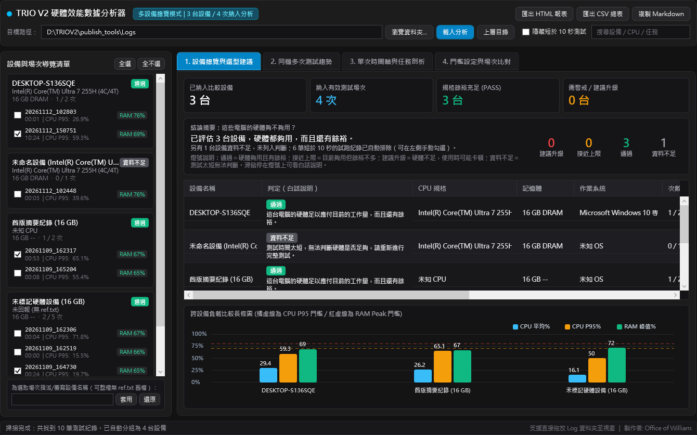
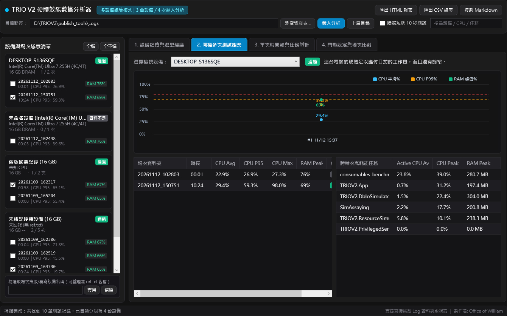
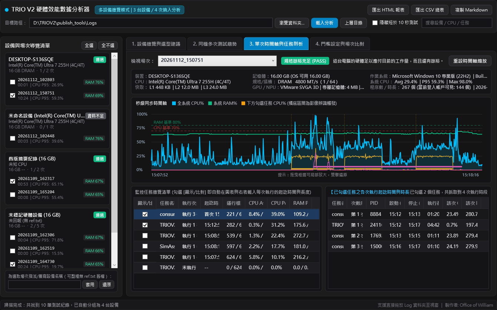
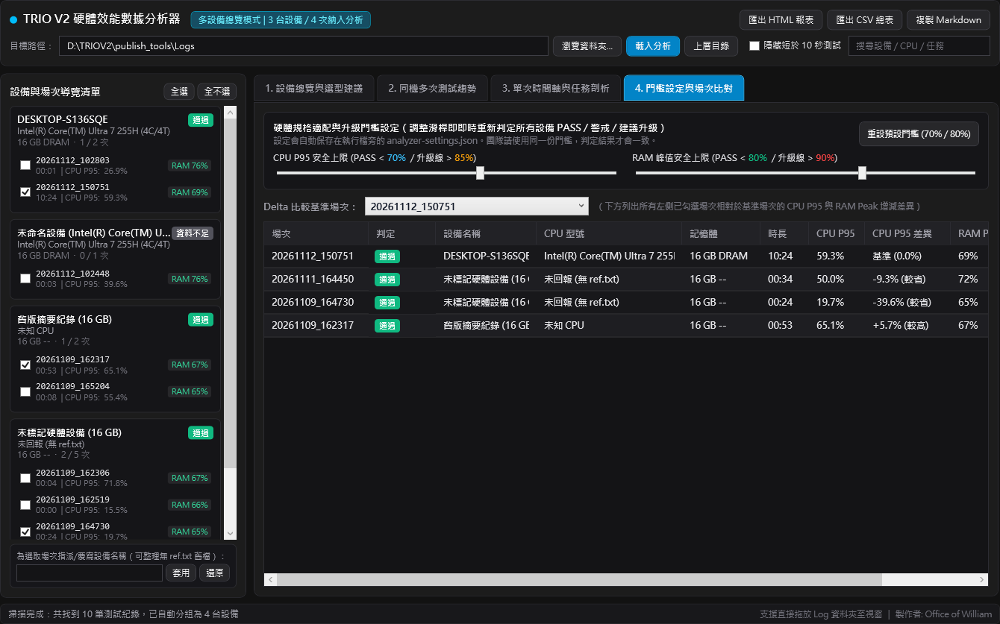

# TRIO V2 硬體效能數據分析器 使用手冊

更新日期：2026-11-27
工具檔名：`TRIOV2.PerformanceAnalyzer.exe`（免安裝，雙擊即可執行）

> 這個工具回答一個問題：**「這幾台電腦的硬體，夠不夠跑 TRIO V2？」**
> 它會依每台電腦的測試紀錄給出「通過／接近上限／建議升級／資料不足」的判定，並附上白話說明與升級方向。
>
> 若要看「單場測試有沒有效能問題（例如記憶體洩漏、程式重啟）」，請改用 **TRIOV2 效能分析工具**（`TRIOV2.PerformanceAnalysis.exe`，手冊在 `src\Tools\PerformanceAnalysisO\docs\10-user-manual.md`）。

---

## 這份手冊怎麼讀

| 你是… | 想做什麼 | 建議閱讀 | 時間 |
|---|---|---|---|
| **主管／決策者** | 決定硬體規格、要不要升級 | [第 1 章](#1-一分鐘認識判定燈號)、[第 4 章](#4-主管快速判讀3-分鐘) | 5 分鐘 |
| **測試執行者**（產線、驗證、PM） | 收集數據、產生報告給主管 | 第 1 – 4 章 | 15 分鐘 |
| **SW 工程師** | 找出耗資源的程式、調整判定標準 | 全部，重點在[第 5 – 7 章](#5-sw-深入分析) | 30 分鐘 |

---

## 1. 一分鐘認識判定燈號

| 燈號 | 意思 | 建議決策 |
|---|---|---|
| 🟢 **通過** | 硬體夠用，而且還有餘裕 | 可採用此規格 |
| 🟡 **接近上限** | 目前夠用，但餘裕不多；之後功能增加可能不夠 | 可暫用；新採購建議提高一級規格 |
| 🔴 **建議升級** | 硬體不足以穩定應付目前的工作量，使用時可能卡頓 | 依建議升級處理器或記憶體 |
| ⚪ **資料不足** | 測試太短（不到 10 秒），無法判斷 | 重新進行完整測試，不要以此下結論 |

判定依據兩個數字（門檻可在第 4 頁調整，見[第 6 章](#6-判定規則與門檻)）：

- **處理器（CPU）P95**：測試期間 95% 的時間，處理器使用率都低於這個數字。
- **記憶體（RAM）峰值**：測試期間記憶體使用率的最高值。

---

## 2. 取得數據（在受測儀器上）

> 這一章給**負責跑測試的人**。只負責看報告可以跳到[第 4 章](#4-主管快速判讀3-分鐘)。

1. 在受測電腦上開啟 `Tools` 資料夾（隨身碟部署時，在隨身碟的 `Tools`），雙擊 **`啟動效能資源監控紀錄器.bat`**。
2. 勾選要監測的程式（例如 `TRIOV2.App`），按 **開始紀錄**，照正常流程操作儀器。
3. 完成後按 **⏹ 停止紀錄**。每次「開始／停止」會產生一個以開始時間命名的資料夾：

```text
Tools\ResourceSimulator\Logs\
└── 20261112_150751\                 ← 一次測試
    ├── ref.txt                       ← 電腦硬體規格（CPU、記憶體、OS…）
    ├── System_BenchmarkLog.csv       ← 整台電腦的每秒紀錄
    └── TRIOV2.App\
        └── TRIOV2.App_BenchmarkLog.csv
```

**注意事項：**

- **整個資料夾一起複製**，尤其不要漏掉 `ref.txt`。少了它，工具就不知道這台電腦的 CPU 與記憶體規格，會顯示「未標記硬體設備」。
- **測試至少 5 分鐘**，並涵蓋實際會用到的操作流程。短於 10 秒的紀錄會被判為「資料不足」並自動排除。
- 要比較多台電腦時，把各台的紀錄放在同一個上層資料夾即可；工具會依硬體規格**自動分組**，不需要手動整理：

```text
硬體評估\
├── 20261112_150751\     ← A 機
├── 20261112_160203\     ← B 機
└── 20261113_093010\     ← A 機（第二次）
```

---

## 3. 開始分析（在你的電腦上）

### 3.1 開啟與載入

1. 雙擊 `TRIOV2.PerformanceAnalyzer.exe`。
   - 工具放在 `D:\TRIOV2\publish_tools\`，可以複製到任何地方使用。
   - 如果執行檔旁有 `Logs` 資料夾，啟動時會自動載入。
2. 載入紀錄，三種方式擇一：
   - 把資料夾**直接拖進視窗**；
   - 按 **「瀏覽資料夾...」** 選擇；
   - 在「目標路徑」輸入後按 Enter 或 **「載入分析」**。

| 你選的資料夾 | 工具的反應 |
|---|---|
| 一次測試（例如 `20261112_150751`） | 開啟第 3 頁「單次時間軸」；按 **「上層目錄」** 可切回多機總覽 |
| 包含多次測試的上層資料夾 | 開啟第 1 頁「設備總覽與選型建議」 |

### 3.2 產生報告分享出去

右上角三個按鈕：

| 按鈕 | 產出 | 適合對象 |
|---|---|---|
| **匯出 HTML 報表** | 單一 `.html` 檔，瀏覽器開啟即可，可另存 PDF | **主管、會議簡報**（最推薦） |
| **匯出 CSV 總表** | 可用 Excel 開啟的設備總表 | 需要自行整理數字的人 |
| **複製 Markdown** | 複製到剪貼簿，可貼到 Teams、Wiki、Git | SW、文件 |

三種報告**最上方都有「結論摘要」**（一句話總結 + 各燈號台數 + 每台設備的白話判定），後面才是技術數字。

---

## 4. 主管快速判讀（3 分鐘）

打開工具（或 HTML 報表），停在 **「1. 設備總覽與選型建議」** 頁：



### 步驟 1：讀「結論摘要」

一句話告訴你整體結果，例如「已評估 3 台設備，硬體都夠用，而且還有餘裕」。右側是各燈號的台數。

如果下方有灰色小字「另有 1 台設備資料不足」「6 筆短於 10 秒的試跑紀錄已自動排除」，代表有些紀錄太短，**沒有被算進判定**，這是正常的。

### 步驟 2：看表格的「判定（白話說明）」欄

每一列是一台電腦：燈號加上一句白話說明。例如：

- 🟢 通過：「這台電腦的硬體足以應付目前的工作量，而且還有餘裕。」
- 🟡 接近上限：「硬體目前夠用，但處理器已接近上限；若之後功能增加或同時執行更多工作，可能會不夠用。」
- 🔴 建議升級：「這台電腦的記憶體不足以穩定應付目前的工作量…建議提高硬體規格。」

最右邊的 **「技術依據與升級建議（SW）」** 欄列出具體數字與升級方向（例如「建議升級記憶體至 32 GB」），可以直接轉給採購或 SW。

### 步驟 3：看長條圖確認差距

下方長條圖比較每台電腦的 CPU 平均、CPU P95、RAM 峰值。**長條超過虛線越多，硬體越吃緊。**

### 步驟 4：做決定

| 看到的狀況 | 建議決策 |
|---|---|
| 全部「通過」 | 目前規格足夠，可以定案 |
| 有「接近上限」 | 現有機台可用；新採購建議提高一級，保留未來功能成長空間 |
| 有「建議升級」 | 依「技術依據與升級建議」欄的方向升級，升級後再測一次確認 |
| 大多是「資料不足」 | 請測試人員依[第 2 章](#2-取得數據在受測儀器上)重新收集完整測試 |

### 名詞白話對照

| 畫面上的詞 | 白話意思 |
|---|---|
| CPU（處理器）使用率 | 電腦運算能力用掉多少。長時間接近 100% 就會卡頓 |
| P95 | 95% 的時間都低於這個數字。比「最高值」更能代表平常的忙碌程度 |
| RAM Peak（記憶體峰值） | 記憶體用量的最高點。接近 100% 時電腦會明顯變慢 |
| 次數「1 / 2」 | 這台電腦有 2 次測試，其中 1 次納入判定（另一次太短被排除） |
| 基準場次 | 拿來當「比較標準」的那一次測試 |
| 差異「+5.7% (較高)」 | 比基準多用了 5.7%，**較高＝較吃資源、較省＝較省資源** |

> **小技巧**：在工具中把滑鼠停在燈號、欄位標題（CPU P95、RAM Peak）或分頁標籤上，會顯示白話說明。

---

## 5. SW 深入分析

### 5.1 畫面配置

| 區域 | 用途 |
|---|---|
| 頂部 | 路徑、瀏覽、載入、上層目錄、「隱藏短於 10 秒測試」、搜尋（設備／CPU／OS／任務名稱）、匯出 |
| 左側清單 | 依設備分組的測試清單。**勾選＝納入該設備的判定**；單擊選取、**雙擊開啟該場次的時間軸** |
| 左下 | 為選取的場次指派設備名稱（整理沒有 `ref.txt` 的舊資料） |
| 右側四個分頁 | 見下表 |

| 分頁 | 回答的問題 |
|---|---|
| 1. 設備總覽與選型建議 | 每台電腦的硬體夠不夠用？ |
| 2. 同機多次測試趨勢 | 同一台電腦多次測試的結果穩不穩定、有沒有變差？ |
| 3. 單次時間軸與任務剖析 | 單一場測試中，每秒的資源使用與各程式何時執行 |
| 4. 門檻設定與場次比對 | 調整判定標準，並把多場測試並排比較 |

### 5.2 設備如何分組

- 有 `ref.txt` 的測試，依硬體指紋（機器名稱、CPU、記憶體等）自動歸為同一台。
- 沒有 `ref.txt` 的舊資料會歸到「未標記硬體設備（xx GB）」。選取該場次後，在左下輸入名稱按 **「套用」** 即可手動歸類；按 **「還原」** 取消。
- 手動名稱存在**被掃描的資料夾**中的 `.trio_analyzer_aliases.json`，同一份資料給其他人時會一起帶過去。

### 5.3 同機多次測試趨勢（第 2 頁）



- 上方選擇設備，右側顯示該設備的判定與白話說明。
- 趨勢圖：每次測試的 CPU 平均、CPU P95、RAM 峰值，用來看版本更新後是否變差。
- 左表：該設備每次測試的數字與燈號；右表：跨所有測試最耗資源的程式排行（只計入程式實際執行中的樣本）。

### 5.4 單次時間軸與任務剖析（第 3 頁）



- **規格帶**：CPU、快取、記憶體規格與插槽、GPU／NPU、OS、程序數。
- **秒級同步時間軸**：藍＝全系統 CPU、綠＝系統 RAM、橘＝勾選任務的 CPU，橘底區間為影像辨識觸發；虛線為 PASS 門檻。
  - 滑鼠移動顯示該秒所有數值與正在執行的任務（含 PID、第幾次執行）。
  - **拖曳框選可局部放大，雙擊還原**；或按右上「重設時間軸縮放」。
- **監控任務總覽清單**：每個任務的執行次數、起訖時段、運行樣本比例、CPU（全程／運行中）、RAM、磁碟峰值。勾選「顯示/比對」會疊加到時間軸。
- **各次執行明細**：程式中途關閉又重新啟動時，每一次的 PID、起訖時間、時長、該次 CPU／RAM／磁碟。

**典型調查流程（判定為「建議升級」時）：**

1. 第 1 頁「技術依據」欄看是 CPU 還是 RAM 超標，以及「主要耗能程序」。
2. 雙擊該設備的測試，進入第 3 頁。
3. 在時間軸找出超過虛線的時段，滑鼠移上去看當時哪些程式在執行。
4. 在任務清單勾選可疑程式，比對其 CPU 曲線與高峰是否重疊。
5. 在「各次執行明細」確認是否有異常重啟或某一次特別耗資源。
6. 判斷是**程式可優化**還是**硬體真的不夠**，回覆主管。

### 5.5 場次並排比較（第 4 頁）



- 「Delta 比較基準場次」選一次測試當基準，下表列出所有**已勾選**測試的 CPU P95 與 RAM 峰值差異。
- 正值（較高）＝比基準吃資源，負值（較省）＝比基準省資源。
- 可跨設備比較，例如「舊機 vs 新機」或「升級記憶體前 vs 後」。

---

## 6. 判定規則與門檻

### 6.1 單次測試的判定

依序檢查：

1. 沒有有效樣本 → **無數據**
2. 測試短於 10 秒 → **資料不足**
3. CPU P95 > 升級線，或 RAM 峰值 > 升級線 → **建議升級**
4. CPU P95 ≥ 安全上限，或 RAM 峰值 ≥ 安全上限 → **接近上限**
5. 以上皆非 → **通過**

### 6.2 設備的判定

- 只計入左側**已勾選**的測試；短於 10 秒的測試**預設不勾選**（仍可手動勾選）。
- 取已勾選測試中的**最大 CPU P95** 與**最大 RAM 峰值**，套用 6.1 的規則（3–5）。也就是以最吃緊的那次測試為準。
- 該設備只有短於 10 秒的測試、或已勾選的都短於 10 秒 → **資料不足**。
- 沒有勾選任何測試 → **未納入場次**。

### 6.3 升級建議怎麼產生

| 條件 | 建議 |
|---|---|
| RAM 超過升級線，現有 ≤ 8 GB | 升級記憶體至 16 GB |
| RAM 超過升級線，現有 ≤ 16 GB | 升級記憶體至 32 GB |
| RAM 超過升級線，現有 > 16 GB | 升級至更高記憶體容量 |
| CPU 超過升級線 | 更換較高核心數／時脈的 CPU |
| 任一情況 | 附上 CPU 峰值最高的程式名稱，供 SW 評估是否可優化 |

### 6.4 調整門檻

| 門檻 | 預設 | 意義 |
|---|---|---|
| CPU P95 安全上限 | 70% | 低於此值為通過 |
| CPU P95 升級線 | 85% | 超過此值建議升級 |
| RAM 峰值安全上限 | 80% | 低於此值為通過 |
| RAM 峰值升級線 | 90% | 超過此值建議升級 |

- 在第 4 頁拖動滑桿即可，所有判定會**立即重新計算**。升級線會自動維持在安全上限之上。
- 「重設預設門檻」恢復上表的預設值。
- 門檻**自動保存**在執行檔旁的 `analyzer-settings.json`，下次開啟沿用。
- **團隊請使用同一份門檻**，否則不同人看到的燈號會不一樣。要統一時，把這個檔案與執行檔放在一起發給大家即可。

---

## 7. 統計指標定義

| 指標 | 定義 |
|---|---|
| CPU Avg / P50 / P95 / P99 / Max | 系統 CPU 使用率的平均、中位數、第 95 / 99 百分位、最大值 |
| CPU > 80% 占比 | CPU ≥ 80% 的樣本比例 |
| RAM Peak (%) / (GB) | 記憶體使用率／用量的最大值 |
| 任務運行樣本 | 該程式狀態為執行中的樣本數 ÷ 全部樣本數 |
| CPU Avg（全程 / 運行中） | 全部樣本平均 / 只計執行中樣本的平均 |
| 執行次數 | 依 PID 變更與停止區間切分的執行段數 |
| 測試時長 | 第一筆到最後一筆系統樣本的時間差；無樣本時取 `ref.txt` 記載 |

---

## 8. 命令列參數（自動化／批次用）

```powershell
# 開啟並載入指定資料夾
TRIOV2.PerformanceAnalyzer.exe "D:\硬體評估"

# 不開互動畫面，直接輸出 HTML、CSV、Markdown 三份報告後結束（可排程）
TRIOV2.PerformanceAnalyzer.exe "D:\硬體評估" --export "D:\報告輸出"

# 輸出四個分頁的截圖（製作文件用）
TRIOV2.PerformanceAnalyzer.exe "D:\硬體評估" --screenshot "D:\截圖"
```

`--export` 與 `--screenshot` 會使用執行檔旁 `analyzer-settings.json` 的門檻。

---

## 9. 常見問題

**Q：為什麼有些測試前面的勾勾是空的？**
A：短於 10 秒的試跑紀錄預設不納入判定，避免用幾秒鐘的資料下結論。確定要納入時，手動勾選即可。

**Q：顯示「未標記硬體設備」或「舊版摘要紀錄」？**
A：這些測試缺少完整的 `ref.txt`，工具無法得知硬體規格。請重新複製完整資料夾，或在左下手動指派設備名稱。

**Q：同一台電腦被分成兩組？**
A：兩次測試的硬體資訊不同（例如加裝記憶體、改了電腦名稱）。如果其實是同一台，用左下的「套用」指派相同名稱。

**Q：我跟同事看到的燈號不一樣？**
A：門檻不同。比對雙方執行檔旁的 `analyzer-settings.json`，或兩人都按「重設預設門檻」。

**Q：「接近上限」到底要不要升級？**
A：現有機台可以繼續使用；但若是新採購或之後還會加功能，建議提高一級規格，保留成長空間。

**Q：工具會修改紀錄檔嗎？**
A：不會。只會在被掃描的資料夾寫入 `.trio_analyzer_aliases.json`（手動指派的設備名稱），以及在執行檔旁寫入 `analyzer-settings.json`（門檻）。

---

## 10. 檔案位置一覽

| 內容 | 位置 |
|---|---|
| 原始紀錄（受測機） | `Tools\ResourceSimulator\Logs\<測試資料夾>\` |
| 分析工具 | `D:\TRIOV2\publish_tools\TRIOV2.PerformanceAnalyzer.exe` |
| 發佈腳本 | `D:\TRIOV2\publish_tools\Publish_PerformanceAnalyzer.ps1` |
| 原始碼 | `D:\TRIOV2\src\Tools\TRIOV2.PerformanceAnalyzer\` |
| 判定門檻 | `<執行檔所在資料夾>\analyzer-settings.json` |
| 手動設備名稱 | `<被掃描的資料夾>\.trio_analyzer_aliases.json` |
